<a href="https://kingcaleb.com">
  
</a>

<p align="center">
  <a href="https://www.youtube.com/@CalebKing0"></a>
  <a href="https://www.tiktok.com/@calebking.io"></a>
  <a href="https://www.instagram.com/calebking.io/"></a>
  <a href="https://x.com/KingCaleb"></a>
  <a href="https://www.facebook.com/CalebKing0"></a>
  <a href="https://www.linkedin.com/in/calebking3/"></a>
  <br />
  <a href="https://newsletter.kingcaleb.com"></a>
  <a href="https://kingcaleb.com"></a>
  <a href="mailto:info@kingcaleb.com"></a>
</p>

## Hey, I'm Caleb 👋

I went from engineer to **Engineering Director by 30**, and now I break down AI, engineering and the tech industry on YouTube, in plain language and with real examples. I build a lot of what I talk about. I'm a Tech Dad, learning and teaching in public.

```ts
const caleb = {
  role:      "Engineering Director → Educator",
  teaching:  ["AI in plain language", "engineering careers", "shipping fast"],
  building:  "AI-native products with Claude, Next.js, Swift & Kotlin",
  openTo:    ["speaking", "advisory", "brand partnerships"],
  reachMe:   "info@kingcaleb.com",
};
```

## 🚀 What I'm working on

<table>
  <tr>
    <td width="50%"><a href="https://getlaunchkit.app"></a></td>
    <td width="50%"><a href="https://www.coachh.app"></a></td>
  </tr>
  <tr>
    <td width="50%"><a href="https://creatorbase-web.vercel.app/welcome"></a></td>
    <td width="50%"><a href="https://www.safetykit.app"></a></td>
  </tr>
</table>

<sub>Also open source: <a href="https://github.com/CalebKing3/promptLibrary"><b>Prompt Library</b></a>, my favorite AI prompts for image, video and product work.</sub>

## 🎥 Latest on YouTube

<!-- BEGIN YOUTUBE-CARDS -->
[](https://www.youtube.com/shorts/S7YHjrL9Hfk#gh-dark-mode-only)[](https://www.youtube.com/shorts/S7YHjrL9Hfk#gh-light-mode-only)
[](https://www.youtube.com/shorts/Mj5dSmSQzfs#gh-dark-mode-only)[](https://www.youtube.com/shorts/Mj5dSmSQzfs#gh-light-mode-only)
[](https://www.youtube.com/shorts/FQtrJhnNu9M#gh-dark-mode-only)[](https://www.youtube.com/shorts/FQtrJhnNu9M#gh-light-mode-only)
[](https://www.youtube.com/shorts/b5OE_p0a820#gh-dark-mode-only)[](https://www.youtube.com/shorts/b5OE_p0a820#gh-light-mode-only)
[")](https://www.youtube.com/shorts/04BmvwAQtR8#gh-dark-mode-only)[")](https://www.youtube.com/shorts/04BmvwAQtR8#gh-light-mode-only)
[")](https://www.youtube.com/shorts/dKZniKGPJ_4#gh-dark-mode-only)[")](https://www.youtube.com/shorts/dKZniKGPJ_4#gh-light-mode-only)
<!-- END YOUTUBE-CARDS -->

## ✉️ Latest from Build Different

<!-- NEWSLETTER:START -->- **[Keep the Receipts: The 2-Minute AI Log You Should Start Today](https://newsletter.kingcaleb.com/p/keep-the-receipts-the-2-minute-ai)** <sub>· Oct 24, 2026</sub>
- **[Before You Let an AI Shop or Log In for You, Do This First](https://newsletter.kingcaleb.com/p/before-you-let-an-ai-shop-or-log)** <sub>· Oct 24, 2026</sub>
- **[How Tesla&#39;s Roadster Actually Flips &lpar;It&#39;s a Vacuum and a Fire Extinguisher&rpar;](https://newsletter.kingcaleb.com/p/how-teslas-roadster-actually-flips)** <sub>· Oct 23, 2026</sub>
- **[0 to 60 in 0.81 Seconds? Read the Fine Print Before You Pay a Dime](https://newsletter.kingcaleb.com/p/0-to-60-in-081-seconds-read-the-fine)** <sub>· Oct 22, 2026</sub>
- **[Which AI Agent Is Right for You? Claude Duet vs. Dots vs. Muse vs. Grok Bot](https://newsletter.kingcaleb.com/p/which-ai-agent-is-right-for-you-claude)** <sub>· Oct 22, 2026</sub>
<!-- NEWSLETTER:END -->

## 🧰 Toolbox

<p>
  
</p>

<p>
  
  
  
  
  
  
</p>

## 🐍 Shipping, one square at a time

<picture>
  <source media="(prefers-color-scheme: dark)" srcset="https://raw.githubusercontent.com/CalebKing3/CalebKing3/output/snake-dark.svg" />
  
</picture>

<p align="center">
  <sub>Videos and newsletter update automatically every day. Built with ☕ and Claude.</sub>
</p>
